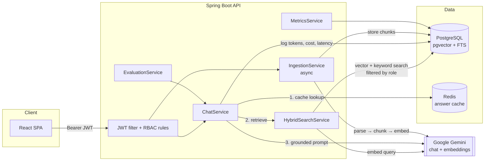

# RAG-Powered Enterprise Document Assistant

An enterprise knowledge assistant: employees ask questions in plain English and get **accurate, cited answers** drawn only from company documents **they are allowed to see**.

     

> **Status:** in active development. The core pipeline (ingestion → hybrid retrieval → cited generation → evaluation) is complete and tested; see the [roadmap](#roadmap).

---

## Features

| | |
|---|---|
| **RAG pipeline** | Ingests **PDF, Word (.docx), Markdown, HTML, wiki pages (by URL)** and other Tika-supported formats. Text is chunked with a token-aware, structure-aware chunker and embedded into **PostgreSQL + pgvector** (HNSW index). |
| **Hybrid search** | **Semantic** (cosine similarity on embeddings) + **keyword** (Postgres full-text search with stemming, headings weighted higher) merged with **Reciprocal Rank Fusion**. |
| **Permission-aware answers (RBAC)** | Each document lists the roles allowed to read it. The permission filter runs **inside the SQL query**, so restricted chunks never leave the database and can never reach the LLM prompt. JWT authentication, role-based endpoint rules. |
| **Citations with page references** | Every claim is cited as `[n]`; the UI links each marker to the source passage with **document, page number (PDF) or section heading**. Hallucinated citation numbers are discarded, and the assistant refuses when the documents don't contain the answer. |
| **Evaluation suite** | A golden dataset runs through the live pipeline and reports **retrieval hit rate, MRR, keyword recall, citation rate, refusal accuracy, RBAC leakage**, and optional **LLM-as-judge faithfulness**. |
| **Cost & latency tracking** | Every question logs prompt/completion/embedding tokens, **USD cost**, retrieval and generation latency. Admin dashboard shows p50/p95 latency, spend, cache hit rate and grounded-answer rate. |
| **Saved chat history** | Every conversation is stored in Postgres per user (Flyway `V2__conversations.sql`), so chats survive sign-out and restarts; all queries are scoped to the owner. |
| **Redis answer cache** | Cache keys include the user's role set (RBAC holds on cache hits) and a corpus version that is bumped on every ingest/delete for O(1) invalidation. |

## Architecture



### Question answering flow

1. **Cache** — look up `hash(normalised question + user's roles)` under the current corpus version in Redis.
2. **Embed** the question (`gemini-embedding-001`, 1536 dimensions).
3. **Retrieve with two strategies**, both restricted by `documents.allowed_roles && user_roles`:
   - semantic: top-20 by cosine distance via the HNSW index, below-threshold matches dropped;
   - keyword: top-20 by `ts_rank_cd` on a weighted `tsvector` (section headings weight A, body weight B).
4. **Fuse** with Reciprocal Rank Fusion (`k = 60`) and keep the top 6.
5. **No permitted match → refuse** without calling the LLM (saves cost, prevents guessing).
6. **Generate** with a strict grounding prompt: numbered passages, cite every sentence, fixed refusal sentence, treat context as data (prompt-injection guard).
7. **Verify citations** — parse `[n]` markers, drop numbers that don't exist, mark which sources were actually used.
8. **Log** tokens, cost and latency; cache grounded answers.

### Ingestion flow

`upload → SHA-256 dedupe → PENDING → (async pool) parse → chunk → embed in batches → store → READY`

- **Parsers:** PDFBox per page (exact page numbers), Apache POI for DOCX (splits on Heading styles, flattens tables), Jsoup for HTML/wiki (strips nav/footer/scripts, splits on h1–h6, keeps table rows), heading-aware Markdown, Apache Tika (via Spring AI) as fallback.
- **Chunker:** paragraphs → sentences → word windows so every unit fits; greedy packing to 400 tokens with 60-token overlap; chunks never cross a page/section boundary so citations stay exact.
- **Contextual chunk headers:** the document title and section are prepended to the text that is *embedded* (not stored), so short chunks keep the context they lost when they were cut out of the document.

## How RBAC is enforced

| Layer | Mechanism |
|---|---|
| Authentication | Stateless JWT (HS256) carrying user id and roles; BCrypt-hashed passwords. |
| Endpoints | `/api/admin/**`, `/api/eval/**`, `/api/metrics/**` and document upload/delete require `ADMIN`. |
| Retrieval | `WHERE d.status = 'READY' AND (:isAdmin OR d.allowed_roles && :userRoles)` in both the vector and the keyword query. |
| Cache | Role set is part of the cache key, so an HR answer is never served to an employee. |
| Document API | Forbidden and missing documents both return 404, so restricted titles cannot be probed. |
| Verification | Integration tests against real pgvector, plus RBAC cases in the evaluation dataset (`leakage` must be 0). |

## Quick start

**Prerequisites:** [Docker Desktop](https://www.docker.com/products/docker-desktop/) and a Google Gemini API key (free at [aistudio.google.com/apikey](https://aistudio.google.com/apikey)).

**0. Get the code.**

```bash
git clone https://github.com/Sagan2k4/rag-enterprise-document-assistant.git
cd rag-enterprise-document-assistant
```

**1. Add your API key (one time only).** Copy `.env.example` to `.env` and put your key in it:

```bash
cp .env.example .env          # Windows: copy .env.example .env
```

```env
GOOGLE_GENERATIVE_AI_API_KEY=your-gemini-api-key
GEMINI_CHAT_MODEL=gemini-3.5-flash
JWT_SECRET=any-long-random-string-of-at-least-32-characters
```

`.env` is git-ignored; never commit your key.

**2. Start the app.**

| | Windows (easiest) | Any OS (terminal) |
|---|---|---|
| Start | Double-click **`start.bat`**: it starts Docker Desktop if needed, starts all services, waits until they are healthy and opens the browser | `docker compose up -d --build` |
| Stop | Double-click **`stop.bat`** (your data is kept) | `docker compose stop` |

The first start downloads and builds everything and takes a few minutes; later starts take about 30 seconds.

**3. Open http://localhost:3000** and sign in with a demo account. On first start the app seeds these users and a small fictional company knowledge base (handbook PDF, IT security policy, travel & expense wiki page, engineering onboarding, HR compensation guidelines, finance close procedures) with different access levels.

| User | Password | Roles | Try asking |
|---|---|---|---|
| `admin` | `admin123` | ADMIN | anything, plus Insights & Evaluation pages |
| `alice` | `password` | HR, EMPLOYEE | "What is the salary range for an L5 Senior Software Engineer?" ✅ |
| `bob` | `password` | ENGINEERING, EMPLOYEE | "What is the SEV1 acknowledgement time?" ✅ |
| `carol` | `password` | FINANCE, EMPLOYEE | "What is the accrual threshold at quarter end?" ✅ |
| `dave` | `password` | EMPLOYEE | "What is the salary range for an L5 Senior Software Engineer?" ❌ refused (HR-only document) |

> These are demo credentials for local use. Change them before deploying anywhere public.

### Using the app

| Page | Who | What you can do |
|---|---|---|
| **Ask** | everyone | Ask questions in plain English. Click a `[n]` marker or the *sources* pill to see the exact passage, document and page. Every chat is **saved automatically** in the *Chats* sidebar: reopen, continue or delete it later, even after signing out or restarting. |
| **Documents** | everyone (upload: admin) | See the documents you may read. Admins upload PDF/DOCX/MD/HTML files or import a wiki URL and choose which roles may read it. |
| **Insights** | admin | Questions asked, cost in USD, p50/p95 latency, cache hit rate, grounded-answer rate, recent queries. |
| **Evaluation** | admin | Run the golden-dataset test suite and compare retrieval/answer quality across runs. |

Sign-in lasts for the browser tab only: opening the app in a new tab or after closing the browser asks for credentials again (your chats are still there).

### Troubleshooting

| Symptom | Fix |
|---|---|
| *"The AI service's usage limit has been reached"* | The Gemini free tier allows a limited number of requests per day. Wait for the daily reset, set `GEMINI_CHAT_MODEL=gemini-2.5-flash` in `.env` (separate free quota) and restart, or enable billing on your Google AI Studio project. Previously answered questions still work from the cache. |
| `start.bat` waits forever / *"failed to connect to the docker API"* | Docker Desktop is not running. Open it from the Start menu, wait until it shows *Engine running*, then run `start.bat` again. On Windows, Docker needs WSL 2 (`wsl --install` in an admin terminal). |
| Page shows old styling or a blank screen after an update | Hard-refresh with **Ctrl + F5**. |
| Port 3000 / 8080 / 5432 / 6379 already in use | Stop the other program using it, or change the left-hand port in `docker-compose.yml`. |
| See what the backend is doing | `docker compose logs -f backend` |
| Start completely fresh (deletes users, documents and chats) | `docker compose down -v`, then start again. |

### Local development (without Docker for the apps)

```bash
docker compose up postgres redis        # infrastructure only

cd backend
export GOOGLE_GENERATIVE_AI_API_KEY=...  # PowerShell: $env:GOOGLE_GENERATIVE_AI_API_KEY="..."
./mvnw spring-boot:run                  # Windows: mvnw.cmd spring-boot:run

cd frontend
npm install
npm run dev                             # http://localhost:5173 (proxies /api to :8080)
```

### Tests

```bash
cd backend && ./mvnw test
```

Unit tests cover the chunker, parsers (including the sample PDF's page numbers), RRF fusion, keyword-query sanitisation, citation extraction, prompt building, cost calculation, JWT handling and HTTP security rules (including a forged-role token). `ChunkRepositoryIntegrationTest` runs the real migrations and search SQL on a `pgvector/pgvector:pg16` Testcontainer to prove the database-level permission filter; it is skipped automatically when Docker is unavailable and always runs in CI.

## API

| Method | Path | Role | Description |
|---|---|---|---|
| POST | `/api/auth/login` | public | Returns a JWT |
| GET | `/api/auth/me` | any | Current user |
| POST | `/api/chat/ask` | any | `{ "question": "...", "conversationId": 12 }` → answer, sources, metrics, `conversationId` (omit the id to start a new chat) |
| GET | `/api/chat/conversations` | any | The caller's saved chats, newest first |
| GET | `/api/chat/conversations/{id}` | owner | One saved chat with every question and answer (sources included) |
| DELETE | `/api/chat/conversations/{id}` | owner | Delete a saved chat |
| GET | `/api/documents` | any | Documents visible to the caller |
| POST | `/api/documents` | ADMIN | Multipart upload: `file`, `title`, `allowedRoles` |
| POST | `/api/documents/wiki` | ADMIN | Import a wiki page by URL |
| DELETE | `/api/documents/{id}` | ADMIN | Delete a document and its chunks |
| GET | `/api/metrics/dashboard?days=7` | ADMIN | Cost, latency, quality metrics |
| POST | `/api/eval/runs?judge=false` | ADMIN | Run the evaluation suite |
| GET | `/api/eval/runs`, `/api/eval/runs/{id}` | ADMIN | Evaluation history |
| GET | `/api/admin/users`, POST `/api/admin/users` | ADMIN | User management |

<details>
<summary>Example response shape from <code>/api/chat/ask</code> (values illustrative)</summary>

```json
{
  "answer": "Full-time employees receive 20 days of paid annual leave per calendar year, plus public holidays [1]. Up to 5 unused days can be carried over and expire on March 31 [1].",
  "sources": [
    {
      "number": 1, "cited": true, "documentTitle": "Employee Handbook", "pageNumber": 2,
      "section": null, "snippet": "Page 2 - Time Off and Leave ...", "fusedScore": 0.0328,
      "vectorRank": 1, "keywordRank": 1
    }
  ],
  "grounded": true,
  "cached": false,
  "model": "gemini-3.5-flash",
  "metrics": { "latencyMs": 1420, "retrievalMs": 210, "generationMs": 1190,
               "promptTokens": 1630, "completionTokens": 58, "embeddingTokens": 12, "costUsd": 0.00028 }
}
```
</details>

## Configuration

All tunables live under `rag.*` in [`application.yml`](backend/src/main/resources/application.yml):

| Property | Default | Meaning |
|---|---|---|
| `rag.chunking.max-tokens` / `overlap-tokens` | 400 / 60 | Chunk size and overlap (cl100k tokens) |
| `rag.retrieval.top-k` | 6 | Passages sent to the LLM |
| `rag.retrieval.candidate-k` | 20 | Candidates from each retriever before fusion |
| `rag.retrieval.rrf-k` | 60 | RRF damping constant |
| `rag.retrieval.min-similarity` | 0.20 | Cosine floor for semantic candidates |
| `rag.cache.ttl` | 30m | Answer cache TTL |
| `rag.pricing.*` | Gemini Flash prices | USD per 1M tokens, used for cost tracking |

## Project structure

```
backend/src/main/java/com/enterprise/rag
├── chat/           ChatService (RAG orchestration), PromptBuilder, CitationExtractor, AnswerCache,
│                   ConversationService + ConversationRepository (saved chat history)
├── retrieval/      HybridSearchService, ReciprocalRankFusion, ChunkRepository (pgvector + FTS SQL)
├── ingestion/      DocumentParser, TextChunker, EmbeddingService, IngestionService, sample seeder
├── document/       Document entity, upload / wiki import / delete API
├── evaluation/     Golden-dataset runner, metrics, LLM-as-judge
├── observability/  Query logs, cost calculator, metrics dashboard
├── security/       JWT service + filter, roles
├── user/           Users, login, admin user management
└── config/         Security, async executor, typed properties
backend/src/main/resources
├── db/migration/   Flyway schema (pgvector, HNSW, GIN, generated tsvector)
├── seed-docs/      Fictional company documents with access levels
└── eval/           golden-dataset.json
frontend/src        React + TypeScript: Ask (with chat history), Documents, Insights, Evaluation pages
start.bat / stop.bat  One-click start and stop on Windows
docker-compose.yml    Postgres (pgvector), Redis, backend, frontend (nginx)
```

## Design decisions

- **Own SQL instead of a generic vector-store abstraction.** Hybrid search and permission filtering need joins against the documents table and a full-text index; plain SQL on pgvector keeps both in one query plan and one database (no separate vector DB to keep in sync with permissions).
- **RRF instead of weighted score blending.** Cosine similarity and `ts_rank_cd` live on incomparable scales; RRF uses ranks only and needs no tuning.
- **Refuse early.** If no permitted chunk matches, the LLM is never called — cheaper, faster and impossible to hallucinate from.
- **Async ingestion with status tracking** so large uploads don't block requests; SHA-256 dedupe stops the same file being indexed twice.
- **Evaluation as a first-class feature.** Retrieval and generation changes (chunk size, top-k, prompt) can be measured instead of guessed, and RBAC regressions show up as non-zero leakage.

## Roadmap

- [ ] Streaming answers (SSE)
- [x] Saved, per-user chat history
- [ ] Follow-up questions that use earlier turns as context (query rewriting)
- [ ] Cross-encoder re-ranking stage
- [ ] OCR for scanned PDFs
- [ ] SSO (OIDC) and group sync from the identity provider
- [ ] Confluence / SharePoint connectors with scheduled re-sync
- [ ] Per-user rate limiting and token budgets in Redis
